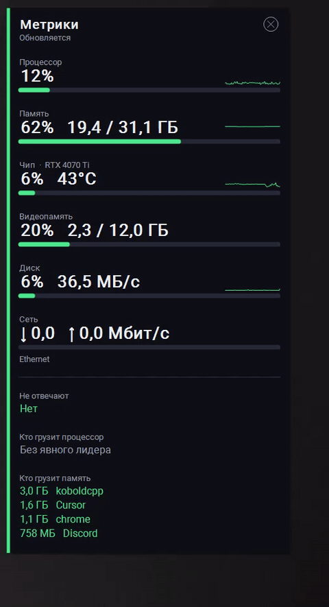

# Glance



Панель метрик поверх рабочего стола для Windows. Её можно оставить на втором мониторе и смотреть, когда игра зависла или компьютер начал тормозить.

Показывает:

- процессор, память, чип видеокарты и видеопамять
- диск и сеть
- кто сильнее всего грузит процессор и память
- топ-5 раздела при наведении на его полоску
- приложения, которые качают или отдают больше 5 Мбит/с
- окна, которые не отвечают

Панель всегда поверх остальных окон, её можно перетащить за любое место. Это отдельное окно, не внутриигровой оверлей.

## Сборка

Нужен .NET Framework 4.x, отдельный SDK не нужен. Из папки проекта:

```bat
C:\Windows\Microsoft.NET\Framework64\v4.0.30319\csc.exe /nologo /t:winexe /platform:x64 /optimize+ /codepage:65001 /win32manifest:src\app.manifest /out:Glance.exe /r:System.dll /r:System.Drawing.dll /r:System.Windows.Forms.dll src\Glance.cs
```

Готовый `Glance.exe` лежит в релизах.

## Запуск с Windows

Имена приложений в сети и автозапуск без повторного окна UAC требуют одного запуска от администратора. После этого задача планировщика «Glance» стартует панель при входе сама.

```powershell
powershell -File register-task.ps1 -Exe "$PWD\Glance.exe"
```

Ярлык на `wscript.exe //B open.vbs` открывает уже запущенную задачу без нового окна.

## Шрифт

В `fonts/` лежит Roboto. Это шрифт Google, лицензия Apache 2.0: https://github.com/googlefonts/roboto

## Лицензия

Код — MIT, см. [LICENSE](LICENSE).
